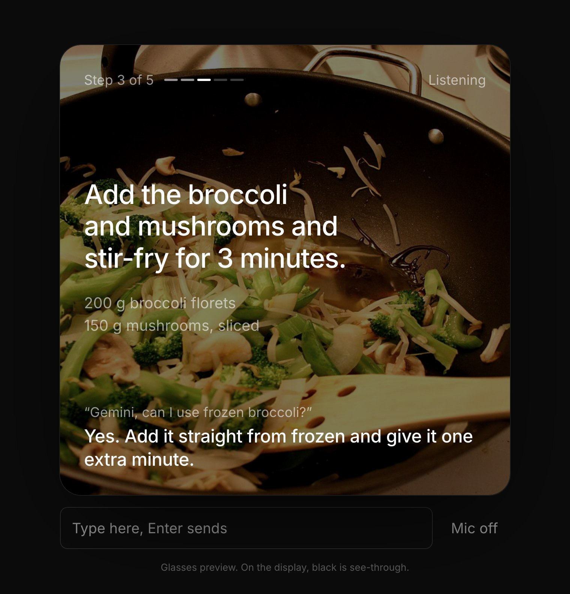
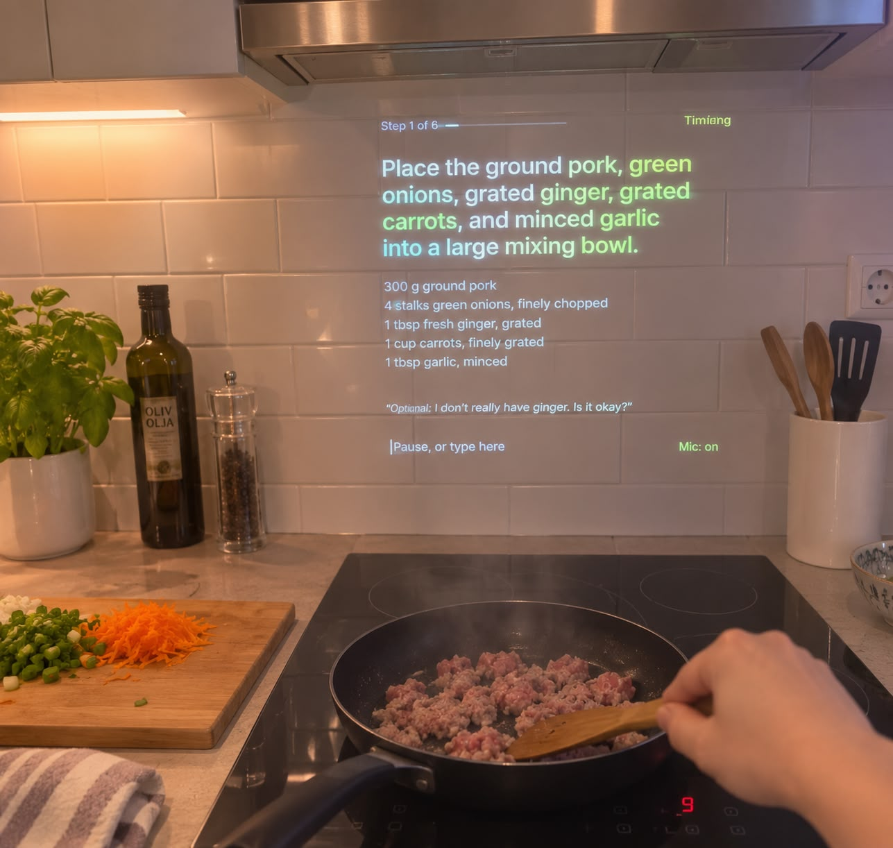
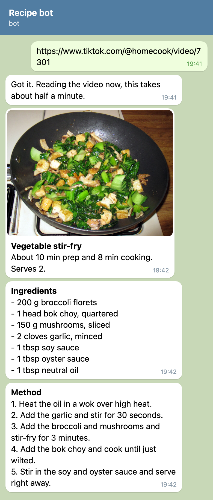

# Cooking assistant for Meta Ray-Ban Display

Cook from a recipe without touching your phone. The glasses show one step at a time. Say "next" when you're ready. When you're unsure, ask, and the assistant looks at your pan before it answers.

Built at Junction 2026 for Meta's *AI Glasses for Everyone, Everyday* challenge.

<p align="center">
  
</p>
<p align="center"><sub>The display over a kitchen, as the wearer sees it. On the glasses, black is see-through.</sub></p>

## The problem

Recipes live on phones, and phones don't belong next to a stove. Your hands are wet or floury, the screen locks, and you scroll back up to find how much butter it was. And a recipe only knows the recipe. It can say "cook until soft", but it can't see whether your onions are there yet.

We built this for home cooks following a recipe they don't know by heart. It helps most for people who find a phone hard to handle while cooking: hands busy or unsteady, or eyes that need large text.

## What it does



1. **Pick a recipe.** Look at your ingredients and say what you're making. The assistant searches recipe sites, shows a photo and the ingredients, and asks if that's the one. Say "no" and it shows another.
2. **Cook one step at a time.** The display shows the current step and only the ingredients that step uses, with amounts. Say "next" or "back" to move. Those two words work without the wake word and never wait for the model, so the step changes at once.
3. **Ask while you cook.** "Gemini, can I use frozen broccoli?" The assistant takes one photo of your view and answers from the recipe and what it sees, out loud and on the display.
4. **Ask "which one?".** For questions about things in front of you, it marks the answer on a snapshot of your view.
5. **Start from a video.** Send a TikTok cooking video to our Telegram bot and it replies with the recipe: the dish and its photo, the ingredients, then the method.

<p align="center">
  
</p>

## Why glasses

The answer depends on what the camera sees. Ask "what do I do next?" with the beef still pink and you hear "The meat isn't cooked yet. Give it another minute or two, then add a spoonful of soy sauce." A recipe on a phone can't tell you that.

Your hands stay on the food. You read the step at a glance and talk to move on, so there's nothing to wipe and nothing to unlock.

## Input, accessibility and trust

**Input.** Everything works by voice. On the glasses the display also works with the band and D-pad, and there is a text bar for typing or dictation.

**Reading.** Answers are spoken and shown. The current step is set at 36 px, and nothing on the display is smaller than 18 px. The display has no panels or decoration, just bright text on black, which the glasses render as see-through. Animation is limited to new content sliding in, and it turns off when the system asks for reduced motion.

**Language.** It answers in the language you speak. English and Chinese are supported, including matching ingredients to steps.

**Trust.**
- The camera is used only when you ask something. Each question sends one photo to Gemini to answer it. Nothing is streamed or recorded.
- Photos from the glasses stay in memory for the highlight (the last four) and are never written to disk. Logs keep timings and token counts, not images or audio.
- While you cook, it only speaks when you say "Gemini", plus "next" and "back". It never talks unprompted.
- It is instructed to be cautious about food safety. If it can't tell whether something is cooked, it tells you to cook it longer, and if the view is unclear it says so.
- API keys come from the environment and never enter the repository.

## When things go wrong

| Situation | What happens |
|---|---|
| No camera, or permission denied | The assistant is told there's no image and answers from the recipe alone. |
| The camera doesn't answer within 5 seconds | It continues without a photo instead of hanging. |
| Model or network error | One automatic retry, then a spoken apology asking you to say it again. |
| Recipe search takes a while | It says "Let me search." first, so you're never left in silence. |
| A recipe page has no structured data | It falls back to the search model's reading of the page and skips pages without a photo, ingredients and steps. |
| The connection drops | The display shows Disconnected and offers Start over. |
| The assistant is talking | The microphone pauses so it doesn't hear itself. |

## How it works

```
Glasses web app (ui/glasses.html)
        │  WebSocket: display updates out, speech and photos in
        ▼
Session (cooking/orchestrator.py)        state machine: idle → searching → confirming → cooking
        │  tool calls
        ├──► Gemini (cooking/gemini.py)              conversation, vision, highlight boxes
        └──► Recipe search (cooking/webrecipes.py)   web search, then each page's schema.org recipe
```

Code decides everything code can decide, and the model handles language and vision. The session enforces the order of steps, so a fresh photo comes before every cooking answer and the recipe is read before its card closes. It also handles the wake word, step changes and highlight timeouts. The model can't skip these.

**On the device.** The display runs as a web app on Meta Ray-Ban Display. Web apps can't reach the glasses' camera or microphone yet, so in our demo a laptop or phone camera and microphone stand in. All hardware access sits behind one interface (`cooking/device.py`), so a Device Access Toolkit integration can supply the glasses' own camera and microphone without changing anything else.

| Path | What it is |
|---|---|
| `ui/glasses.html` | The display: one state object, one render pass. Doubles as a desktop preview. |
| `cooking/orchestrator.py` | The session state machine and the rules the model can't break. |
| `cooking/steps.py` | "Next" and "back" commands, and which ingredients each step uses. |
| `cooking/gemini.py` | Gemini as the brain, acting only through tools. |
| `cooking/webrecipes.py`, `cooking/page_reader.py` | Recipe search and page reading. |
| `cooking/chat.py`, `Telegram_bot.py` | The Telegram bot and the text it sends. |
| `kitchen/`, `scripts/build_tasks.py` | Replay scenarios and scoring for evaluation. |

## Run it

You need Python 3 (we use 3.13), [uv](https://docs.astral.sh/uv/) and Chrome.

```bash
uv venv && uv pip install -r requirements.txt
export GEMINI_API_KEY=...     # required
.venv/bin/python -m scripts.serve_glasses
```

Open <http://localhost:8765> in Chrome and allow the camera and microphone. In a wide window the page shows the display over your webcam, as in the picture above. On the glasses, open the same address as a web app. It has to be reachable from the glasses, for example through ngrok.

For the Telegram bot, set `TELEGRAM_BOT_TOKEN` and `GEMINI_API_KEY`, install `ffmpeg`, and run `.venv/bin/python Telegram_bot.py`. Deployed (on Fly.io, or anywhere with `PUBLIC_URL` set to the server's address), the server registers a Telegram webhook when it starts and answers the messages itself, so it can stop while idle.

## How we test it

```bash
.venv/bin/python -m pytest
```

90 tests cover the session rules, step commands and ingredient matching, recipe parsing, the bot's messages and the browser protocol.

For the assistant as a whole we use [Harbor](https://github.com/harbor-framework/harbor). A scenario replays camera frames and things the user says along a timeline. Code scores the flow (a fresh photo before each answer, a different recipe after a "no"), whether the highlight lands on the right object, and the time to the first spoken word against a 3-second target. An LLM judge scores what was said. Each scenario also runs with a reference policy and with do-nothing and stop-early baselines, so we know the scoring can tell good runs from bad ones.

## Where it goes next

- **Any recipe site, today.** Most recipe sites publish structured recipe data, and that's what we read, so no partnership is needed to start.
- **A meal-kit pilot.** A meal-kit company could load the exact recipe for the box you're cooking and skip the search. Their customers already cook from step-by-step cards.
- **Cooking with support.** We'd like to test with occupational therapists who teach cooking to people after an injury, where hands-free steps and a second pair of eyes on the pan matter most.

---

<sub>Photos in the screenshots: "Making Stir-Fry" by Mack Male (CC BY-SA 2.0) and "Stir fry" by Karen and Brad Emerson (CC BY 2.0), via Wikimedia Commons.</sub>
